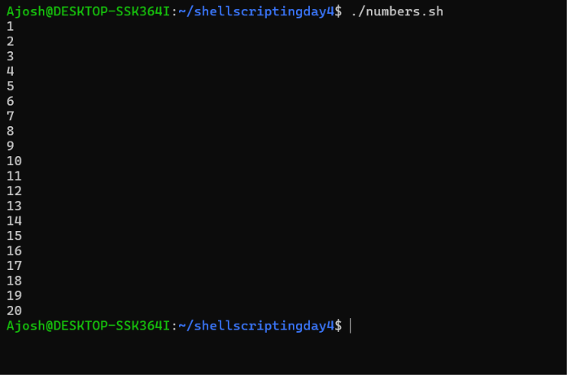
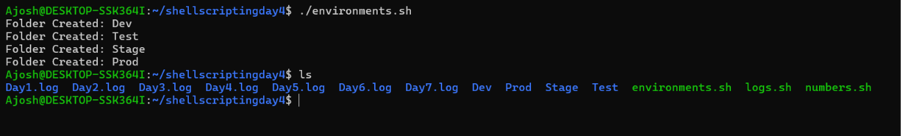
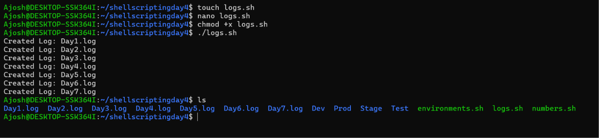
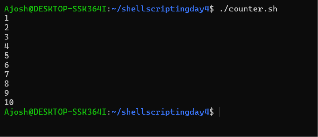
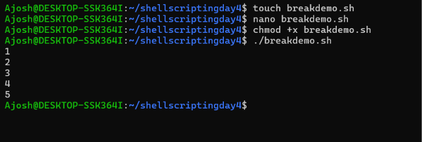
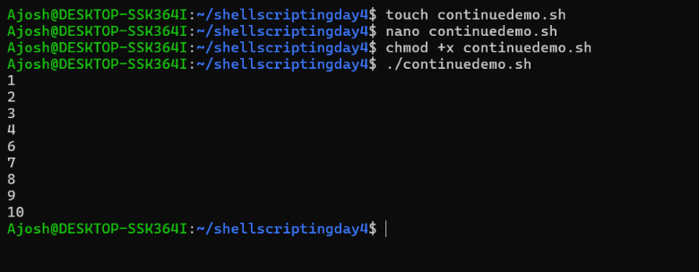
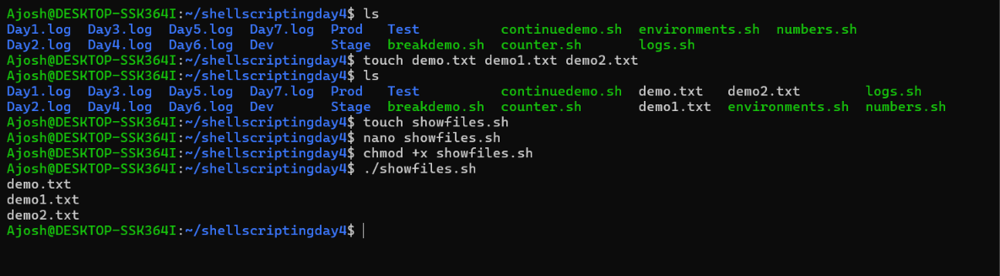
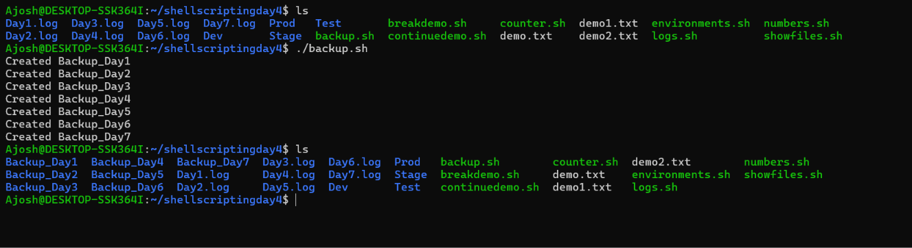

# Day 4 Machine Test – Shell Scripting (Loops)

| | |
|---|---|
| **Student Name** | Ajosh |
| **Batch** | 09:15 - 10:15 |
| **Machine Test Title** | Machine Test – Day 4: Shell Scripting (Loops) |
| **Repository** | day4-shell-machine-test |

## Overview

This repository contains eight Bash scripts that demonstrate loops in shell scripting: `for`, `while`, `break`, and `continue`, along with simple DevOps-style automation using loops.

## List of Tasks

| # | Script | Description |
|---|--------|-------------|
| 1 | `numbers.sh` | Uses a `for` loop to print numbers from 1 to 20, one per line |
| 2 | `environments.sh` | Creates the folders Dev, Test, Stage and Prod |
| 3 | `logs.sh` | Creates `Day1.log` through `Day7.log` using a loop |
| 4 | `counter.sh` | Uses a `while` loop to print numbers from 1 to 10 |
| 5 | `breakdemo.sh` | Loops from 1 to 10 and stops when the value becomes 6 using `break` |
| 6 | `continuedemo.sh` | Prints numbers from 1 to 10 and skips 5 using `continue` |
| 7 | `showfiles.sh` | Lists all `.txt` files using `for file in *.txt` |
| 8 | `backup.sh` | Creates `Backup_Day1` through `Backup_Day7` using a loop |

## Project Structure

```
day4-shell-machine-test/
├── numbers.sh
├── environments.sh
├── logs.sh
├── counter.sh
├── breakdemo.sh
├── continuedemo.sh
├── showfiles.sh
├── backup.sh
├── screenshots/
└── README.md
```

## How to Run

```bash
chmod +x *.sh
./numbers.sh
```

Replace `numbers.sh` with any script name from the table above.

## Screenshots

### Task 1 – numbers.sh


### Task 2 – environments.sh


### Task 3 – logs.sh


### Task 4 – counter.sh


### Task 5 – breakdemo.sh


### Task 6 – continuedemo.sh


### Task 7 – showfiles.sh


### Task 8 – backup.sh


## Concepts Covered

- `for` loops with brace expansion (`{1..20}`) and word lists
- `while` loops with a counter variable
- Loop control with `break` and `continue`
- Glob patterns (`*.txt`) in loops
- Automating file and folder creation with `mkdir` and `touch`
